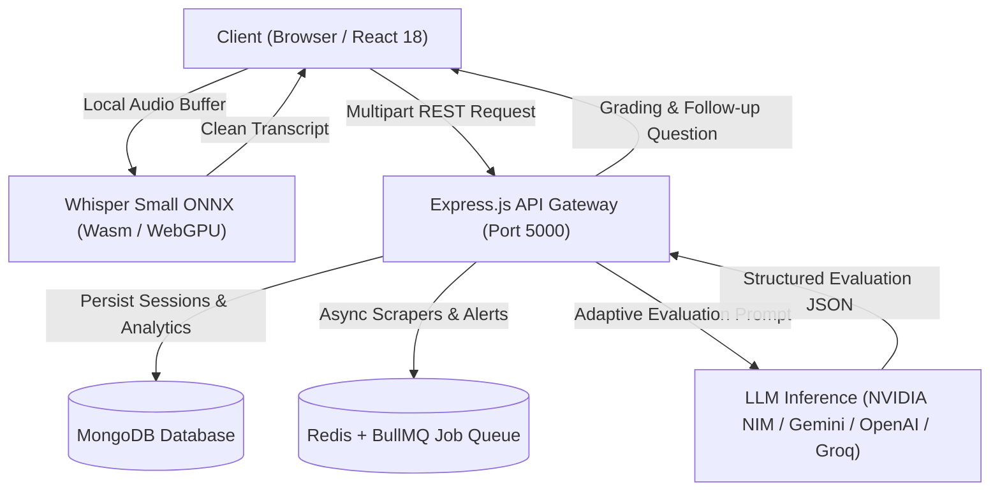

<div align="center">

# 🚀 CareerPilot // xInterview

### Next-Gen AI Career Copilot & Real-Time Mock Interview Simulator

[](https://reactjs.org/)
[](https://vitejs.dev/)
[](https://nodejs.org/)
[](https://tailwindcss.com/)
[](https://www.mongodb.com/)
[](https://redis.io/)
[](https://huggingface.co/Xenova/whisper-small)

---

**CareerPilot** is an end-to-end, production-ready AI career preparation platform designed to help candidates prepare, practice, and secure top-tier engineering and tech roles. It features a real-time, Google Meet-style AI interviewer powered by local ONNX Whisper ASR, adaptive multi-turn LLM reasoning, comprehensive resume roasting, and automated job matching.

</div>

---

## 🌟 Key Features

### 🎙️ 1. Google Meet-Style AI Mock Interviewer
- **Dual-Tile Video Layout**: Clean, distraction-free meeting interface featuring the AI Interviewer on the left and the candidate's live webcam stream on the right.
- **Dynamic AI Avatar**: Interactive avatar with real-time audio waveform reactivity when the AI is speaking.
- **Face & Presence Monitoring**: Client-side face visibility and attention estimation to foster confident eye contact.
- **Frosted Floating Controls**: Quick toggles for microphone, camera, speech recognition engine, in-call text chat, and graceful exit.
- **Hardware & Virtual Camera Integration**: Seamless support for physical webcams and virtual video loopbacks (such as Iriun Webcam, OBS Virtual Cam, and DroidCam).

### ⚡ 2. Local Whisper Small ASR (Client-Side ONNX)
- **High-Accuracy Edge Transcription**: Powered by `@xenova/transformers` running `Xenova/whisper-small` (244M parameters, ~3.3x parameter depth over Whisper-base).
- **Zero Privacy Leakage**: Speech is transcribed directly in the browser via WebAssembly / WebGPU without streaming raw candidate voice to third parties.
- **Cloud Fallback Pipeline**: Graceful degradation to server-side Whisper or Web Speech API if WebAssembly resources are constrained.

### 🔥 3. AI Resume Roast & ATS Scorecard
- **Brutally Honest AI Critique**: Detailed, witty, yet actionable roasting of resumes to highlight clichés, buzzwords, and vague metrics.
- **ATS Parsing & Scoring**: Deep structural parsing analyzing keyword density, impact statements, and recruiter readability.
- **Actionable Bullet Re-writer**: Instant transformation of weak responsibility statements into high-impact, metric-driven achievements.

### 💻 4. Interactive Live Coding & Dry-Run Evaluation
- **In-Browser Code Editor**: Practice technical coding challenges with syntax highlighting and language selection.
- **Dry-Run Test Suite Evaluation**: Non-sandboxed LLM-judged dry-run execution simulating test case validation without Remote Code Execution (RCE) vulnerabilities.

### 🧠 5. Provider-Agnostic LLM Engine (BYOK)
- Supports flexible **Bring-Your-Own-Key (BYOK)** routing across leading providers:
  - **NVIDIA NIM** (Nemotron-3 Super 120B)
  - **Google Gemini** (Gemini 1.5 Pro / Flash)
  - **OpenAI** (GPT-4o / GPT-4o-mini)
  - **Groq** (Llama 3.3 70B Versatile)
  - **Anthropic Claude** (Claude 3.5 Sonnet)

---

## 🏗️ System Architecture



---

## 📁 Repository Structure

```
career-pilot/
├── backend/
│   ├── src/
│   │   ├── config/          # AI providers, LangChain, Redis, database setup
│   │   ├── middleware/      # Auth, rate limiting, validation, file upload
│   │   ├── models/          # MongoDB Mongoose schemas (Interview, User, Job, Resume)
│   │   ├── routes/          # Express route handlers (interview, auth, enhance, roast)
│   │   ├── schemas/         # Zod input validation schemas & unit tests
│   │   └── services/        # Interview engine, ASR routing, resume scoring
│   ├── package.json
│   └── .env.example
├── frontend/
│   ├── public/              # Avatars, logos, audio and static assets
│   ├── src/
│   │   ├── components/      # Reusable UI components & Google Meet layout
│   │   ├── context/         # Auth and session context providers
│   │   ├── hooks/           # Custom hooks (useFaceDetection, useWhisper)
│   │   ├── pages/           # InterviewPrep, ResumeRoast, Dashboard, Login
│   │   ├── services/        # WhisperManager, API client connectors
│   │   └── stores/          # Zustand global stores (useAIConfigStore, useRoastStore)
│   ├── package.json
│   └── vite.config.js
└── README.md
```

---

## 🚀 Getting Started

### Prerequisites
- **Node.js**: v18.0.0 or higher (v20+ recommended)
- **MongoDB**: Local daemon running on `mongodb://localhost:27017` or MongoDB Atlas URI
- **Redis**: Local instance running on port `6379` (for background queues)
- **Git**

---

### 1. Clone & Configure

```bash
git clone https://github.com/aman40399/career-pilot.git
cd career-pilot
```

#### Backend Setup:
```bash
cd backend
npm install
cp .env.example .env
```
Fill in the following variables in `backend/.env`:
```env
PORT=5000
MONGODB_URI=mongodb://localhost:27017/careerpilot
JWT_SECRET=your_jwt_secret_key_here
FRONTEND_URL=http://localhost:5173

# Optional: Add your preferred AI key (or supply via frontend BYOK settings)
GEMINI_API_KEY=your_gemini_key
OPENAI_API_KEY=your_openai_key
NVIDIA_API_KEY=your_nvidia_key
GROQ_API_KEY=your_groq_key
```

#### Frontend Setup:
```bash
cd ../frontend
npm install
```

---

### 2. Run Locally

Open two terminal tabs:

**Terminal 1 (Backend):**
```bash
cd backend
npm run dev
# Server runs on http://localhost:5000
```

**Terminal 2 (Frontend):**
```bash
cd frontend
npm run dev
# Application opens at http://localhost:5173
```

---

## 🧪 Testing

Run backend unit and schema tests:
```bash
cd backend
npm test
```

---

## 🔒 Security & Prompt Hardening
- **Prompt Injection Defense**: All user transcripts and speech strings are wrapped in strict XML tags (`<candidate_response>`) and evaluated under negative-instruction boundaries.
- **Calibrated Rubrics**: Avoids LLM grade inflation by strictly calibrating score boundaries (`90+ = exceptional`, `70-89 = competent`, `<50 = critical gaps`).
- **Decoupled Delivery & Content Metrics**: Content gaps are strictly evaluated separately from acoustic speech delivery and filler word counters.

---

## 📄 License
This project is open-source and available under the [MIT License](LICENSE).
